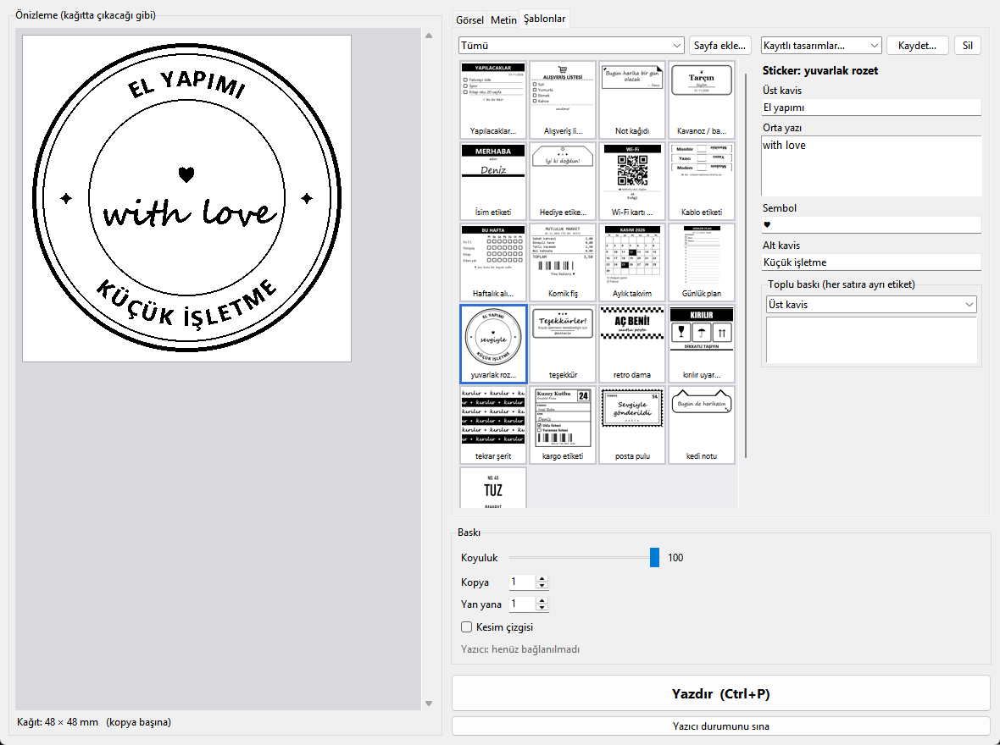
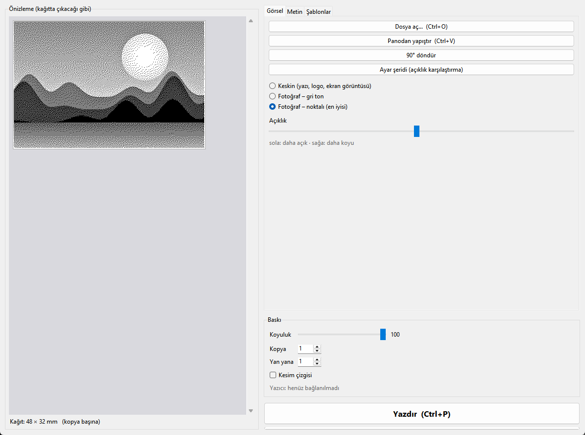
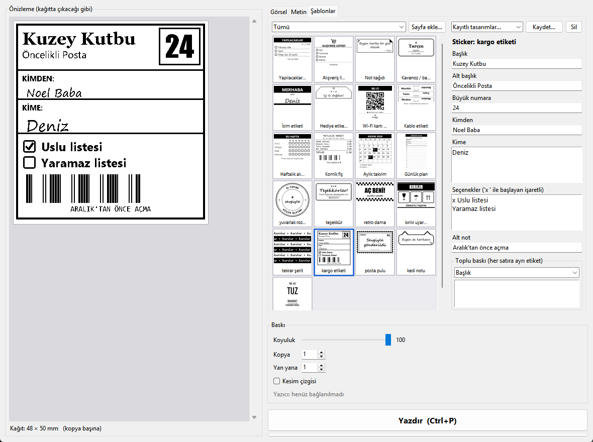
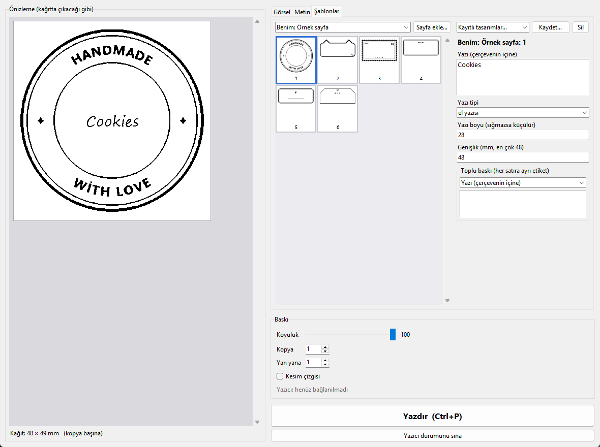
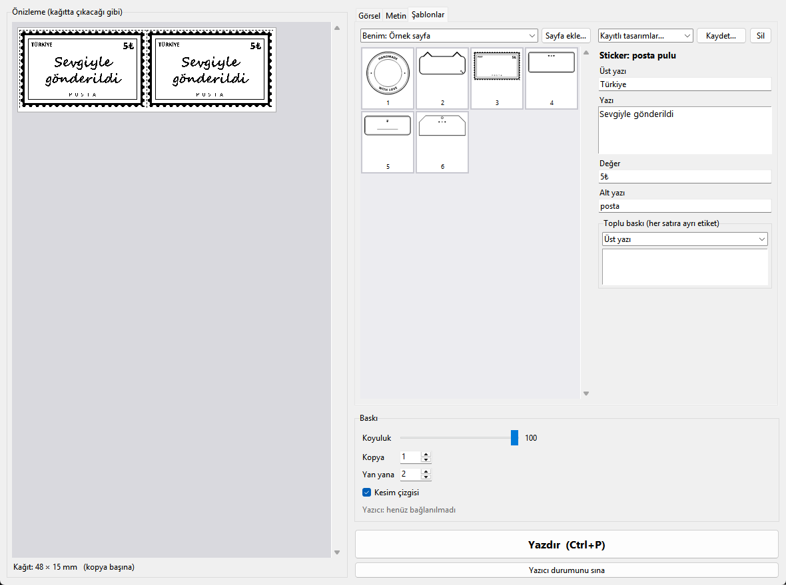
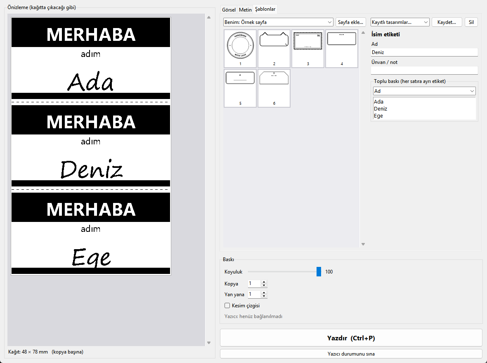
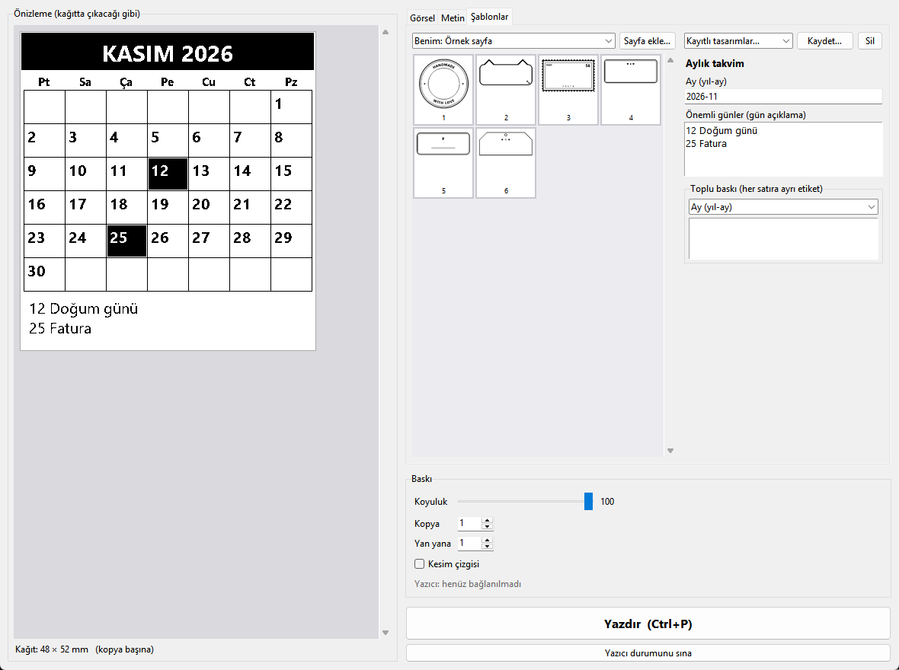
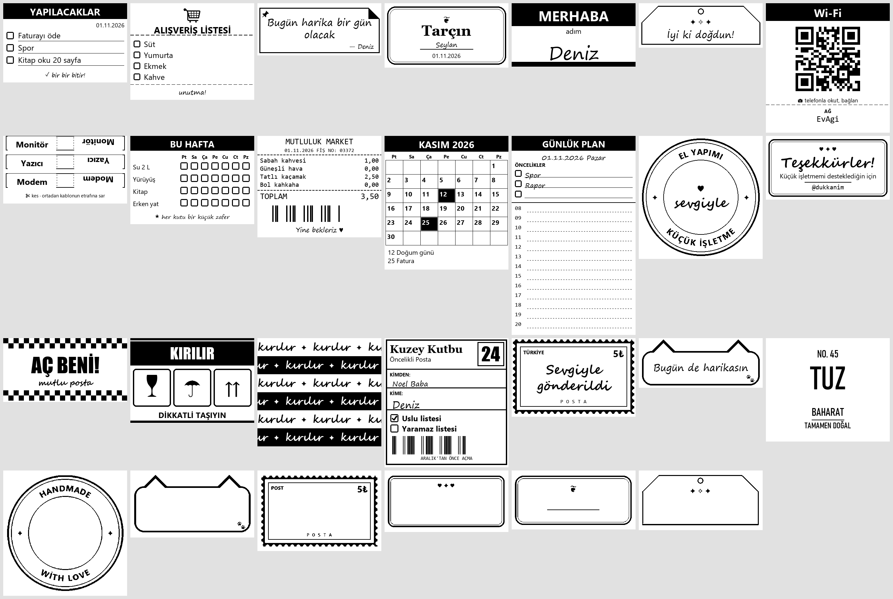
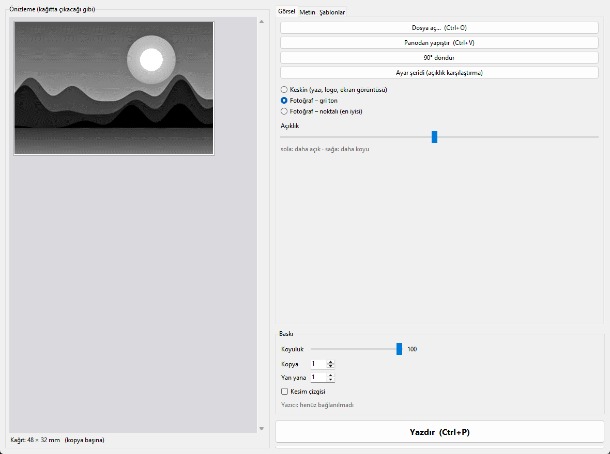
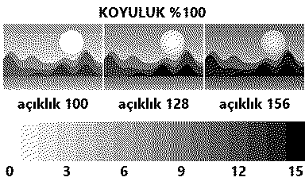

# MXW01 Sticker Printer

**Print stickers, labels, notes and photos from a Windows PC to the MXW01 ("C9", *Fun Print* app) 57 mm
Bluetooth thermal printer — no phone needed.**

A small Python/Tkinter desktop app plus a command-line tool. It talks to the printer directly over Bluetooth LE
(via [bleak](https://github.com/hbldh/bleak)), shows a dot-accurate preview of what will come out of the printer,
and ships with fillable templates. A single-file `.exe` is available on the [Releases](../../releases) page, so no
Python install is required.

> 🇹🇷 Türkçe açıklama aşağıda: [Türkçe](#türkçe)



## Features

| | |
|---|---|
| **Images** — open a file or paste with **Ctrl+V** (e.g. a Win+Shift+S screenshot). Three modes: *Sharp* (text, logos), *Photo – dithered* (Floyd–Steinberg tuned for thermal dot gain; best for faces) and *Photo – grayscale* (the printer's native 16-level mode). |  |
| **Templates** — to-do list, shopping list, note, jar/spice label, name tag, gift tag, Wi-Fi QR card (password only inside the QR), cable flags, habit tracker, funny receipt, monthly calendar, daily planner and sticker designs (round badge with curved text, thank-you, retro checkerboard, fragile, repeating ribbon, parcel label, postage stamp, cat note…). Every field is editable and the preview updates live. |  |
| **Add your own sticker sheet** — pick any sticker sheet image (Pinterest, Etsy, your own drawing). It is cut into individual stickers automatically; for framed stickers the empty writing area is detected so you can type into it. You can drag the text with the mouse in the preview. |  |
| **Side by side + cut lines** — put 1–4 copies of a small sticker on one row and add a dashed cutting guide. |  |
| **Batch printing** — one label per line of a list (name tags, a whole spice-jar series…), separated by cut lines. |  |
| **Calendar & planner** — monthly calendar with highlighted dates, daily planner with priorities and hourly lines. |  |

Also:

- **Saved designs** — store a filled-in template under a name and reprint it with one click.
- **Calibration strip** — prints your photo at three brightness levels side by side plus a 16-step tone ramp,
  so you can pick the best setting for *your* paper and printer.
- **Printer status** — battery %, temperature and errors (out of paper, overheating) after every connection.
- **Quick print** — `MXW01-Sticker-Printer.exe --pano` prints whatever is on the clipboard (image or text)
  without opening a window. Put it on a desktop shortcut with a hotkey (e.g. Ctrl+Alt+P).
- Real-size preview in millimetres, density, copies and a progress bar; Bluetooth runs in a background
  asyncio loop so the window never freezes.

<details>
<summary>All built-in templates</summary>


</details>

<details>
<summary>Grayscale mode and calibration strip</summary>



</details>

## Getting started

1. Download `MXW01-Sticker-Printer.exe` from [Releases](../../releases) (Windows 10/11, a Bluetooth LE adapter).
2. Turn the printer on. **Disconnect it from the phone app first** — the printer accepts only one connection
   and is invisible while the phone is connected.
3. Open the app, pick an image/text/template and press **Print (Ctrl+P)**.

Tips:

- For photos use **Photo – dithered** with density **100 %** and brightness in the middle, then fine-tune
  with the calibration strip.
- If a USB Bluetooth dongle cannot connect, move it from a **USB 3.0** port to a USB 2.0 port or use an extension
  cable — USB 3.0 interferes with 2.4 GHz.

## Command line

```bash
pip install -r requirements.txt
python c9_uygulama.py                         # the app
python c9_yazdir.py picture.png notes.txt     # print images or .txt files
python c9_yazdir.py --gri photo.jpg           # 16-level grayscale
python c9_yazdir.py --metin "Hello"           # print text
python c9_yazdir.py --durum                   # printer status
python c9_sablonlar.py                        # render all templates to a preview PNG
```

## Building the .exe

```bash
pip install pyinstaller
pyinstaller --onefile --noconsole --name "MXW01-Sticker-Printer" --icon c9.ico --add-data "c9.ico;." ^
  --collect-submodules bleak.backends.winrt --collect-submodules winrt --collect-submodules qrcode c9_uygulama.py
```

Optional built-in sticker pack: put `stickerlar/liste.json` and `stickerlar/parcalar/*.png` next to the code and
add `--add-data "stickerlar;stickerlar"`. The format is the one written by "Add sheet" (see `c9_sablonlar.py`).
Only bundle artwork you have the rights to.

## Protocol

Service `AE30` (advertised as `AF30`); characteristics: command `AE01`, notify `AE02`, data `AE03`.
Packet: `22 21 | cmd | 00 | length (LE) | payload | CRC8 | FF`.
Sequence: density (`A2`) → status (`A1`) → print request (`A9`: line count, `0x30`, mode `0` = 1 bit / `2` = 4-bit
gray) → line data on `AE03` → data done (`AD`) → wait for print complete (`AA`).
Status payload: `[0]` state, `[3]` battery %, `[4]` temperature °C, `[6]` 0 = OK, `[7]` error code.

Thanks to [clementvp/mxw01-thermal-printer](https://github.com/clementvp/mxw01-thermal-printer) and
[MaikelChan/CatPrinterBLE](https://github.com/MaikelChan/CatPrinterBLE) for documenting the protocol.

## Project layout

| File | |
|---|---|
| `c9_yazdir.py` | Bluetooth protocol, image processing (dithering, grayscale, layout), CLI |
| `c9_uygulama.py` | Tkinter desktop app |
| `c9_sablonlar.py` | Templates (each: fields + a drawing function returning a 384 px image) |
| `c9_sayfa.py` | Sticker-sheet cutter used by "Add sheet" (pure Pillow, no SciPy) |

The code and UI are in Turkish; contributions and translations are welcome.

## Disclaimer

Not affiliated with the printer's manufacturer or the Fun Print app. Use at your own risk. Fonts are taken from
the Windows font folder (Segoe UI, Segoe Print, Segoe Script, Georgia, Consolas, Impact, Bahnschrift).

## License

[MIT](LICENSE)

---

## Türkçe

**MXW01 ("C9", Fun Print uygulamalı) 57 mm Bluetooth termal yazıcıya Windows bilgisayardan sticker, etiket, not ve
fotoğraf basar; telefon gerekmez.**

- **Görsel:** dosya aç ya da **Ctrl+V** ile yapıştır. Keskin (yazı, logo), **Fotoğraf – noktalı** (en iyisi: koyuluk
  %100, açıklık ortada) ya da Fotoğraf – gri ton (16 ton). **Ayar şeridi** ile açıklığı yazıcına göre seç.
- **Şablonlar:** yapılacaklar, alışveriş, not, kavanoz/baharat, isim, hediye, Wi-Fi QR (şifre yalnız QR'da), kablo,
  alışkanlık, komik fiş, aylık takvim, günlük plan ve stickerlar (kavisli yazılı rozet, teşekkür, retro dama,
  kırılır, şerit, kargo, pul, kedi notu…). Her alan düzenlenir, önizleme canlı güncellenir.
- **Sayfa ekle:** kendi sticker sayfanı (Pinterest vb.) seç; tek tek kesilir, çerçevelerin içine yazı yazarsın, yazıyı
  önizlemede fareyle taşırsın.
- **Yan yana** (1-4 kopya tek satırda), **kesim çizgisi**, **toplu baskı** (listedeki her satıra ayrı etiket),
  **kayıtlı tasarımlar**, **yazıcı durumu** (pil, sıcaklık, hata).
- **Hızlı baskı:** `--pano` panodakini pencere açmadan basar; masaüstü kısayoluna Ctrl+Alt+P gibi bir tuş ata.

Kurulum: [Releases](../../releases) sayfasından exe'yi indir. Yazıcı telefondaki uygulamaya bağlıyken görünmez;
önce oradan bağlantıyı kes. USB Bluetooth adaptörü USB 3.0 portta bağlanamıyorsa USB 2.0 porta tak.
